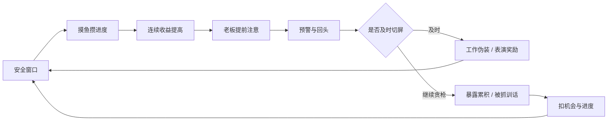
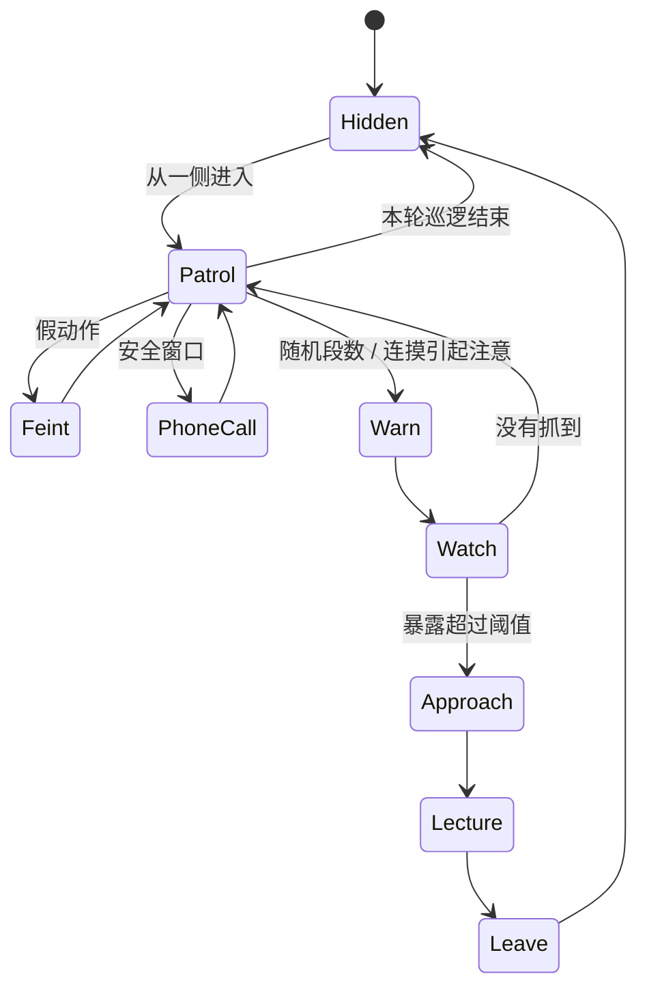

# 玩法与设计思路

## 核心体验：不是打赢枪战，是把摸鱼演过去

这个项目把一个办公室小动作做成了游戏：一边在屏幕上打枪，一边留意老板的动静。玩家不会移动角色，也不需要瞄准。真正的决策只有两个：现在能不能摸鱼，下一秒还要不要继续。

射击小游戏承担“热闹”的部分，主玩法承担“紧张”的部分。屏幕上越忙，玩家就越容易忽略屏幕外的老板；摸鱼收益越高，越舍不得切走。两套反馈因此互相拉扯，而不是争抢操作按键。

## 主循环

一局只有 75 秒。过长会让等待和重复动作占据体验；较短的时间则允许玩家快速失败、理解规则、重开，形成“这次我一定不贪”的循环。

摸鱼值到 100 即可获胜。工作会缓慢损失进度，所以最保守的策略无法完成目标；玩家必须主动承担一些风险。

## 风险如何增长

基础摸鱼收益为每秒 4.4，连续 6 秒逐渐提高到 ×1.6。收益上升本身很直观，但单纯加分容易让安全窗口变成无脑等待，因此它也被接进了老板的行为：连续摸鱼约 5 秒后，老板会更早开始检查。

切换窗口会重置连摸状态。于是“先切一下求稳”并非毫无代价；玩家放弃了即将升高的收益，换取更低的风险。

被抓会扣除至少 15 点或当前一半进度，且只给三次机会。它比固定扣几分更能表达“越贪越心疼”，同时保留了少量犯错空间。倒计时独立存在，避免失败条件只有“等三次被抓”。

## 老板不是一个固定节拍器

老板的主循环由协程驱动，状态包括办公室等待、巡逻、虚晃、接电话、预警、观察、靠近、训话和离开。

随机性主要负责打乱预期，不直接负责扣命。真正的抓人发生在 `Watch`，并要求玩家持续暴露约 0.38 秒。预警时长会随摸鱼进度略微缩短，观察时长也会变化；这些变化让后半局更紧张，但仍保留明确的反应窗口。

接电话提供可以相信的安全窗口，避免所有状态都只是“随时可能抓你”。虚晃和假门响则负责制造紧张，形成松紧交替。

及时切回工作会得到额外进度和“影帝级切屏”反馈。除了躲避惩罚，玩家也有了主动追求精准时机的理由。

## 笑点如何出现

笑点尽量来自规则和场景的反差：

- 射击场景正在爆头连杀，外面的人只看见一份经营分析报告。
- 文件名到了 `final_v7_真的最终版.xlsx`，表格还在“自动保存”。
- 玩家躲过检查，老板甚至会夸他很忙。
- 被抓时突然切回工作已经晚了，老板照样走过来训话。
- 训话结束后，系统又允许玩家继续摸鱼，形成有意的荒诞循环。

脚步、心跳、门响、切屏声和警报为这些事件提供节奏。声音帮助玩家察觉威胁，也能让假警报成立。文案集中在 `Meme.cs`，便于继续加入办公室梗，而不把文案散落在判定逻辑中。

## 固定视角与注意力分配

固定工位视角让三个位置稳定下来：中央显示器负责主要刺激，旁边的老板负责环境威胁，上方雷达负责补充信息。玩家要在这三个区域间来回扫视。

如果加入自由移动或手动瞄准，操作负担会变大，失败原因也会变得模糊。因此射击场景自动瞄准、开火、换弹和复活。它提供反馈与干扰，但不取代切屏这个核心动作。

相机按画面比例适配视野，HUD 采用相机空间 Canvas，显示器内容采用世界空间 Canvas。两者的职责分开，便于保持表格文字和老板预警可读。

## 视觉取舍：卡通化，但保留空间感

办公室通过脚本重建，家具使用原创 Blender 网格，人物可使用仓库自带的程序化简化老板。这样可以让克隆项目后的运行成本较低，也便于研究场景构成。

渲染采用 URP 下的自定义 Toon Shader：分段明暗与连续柔光混合，使用偏冷阴影、暖色主光、少量边缘光和细描边。过于平坦的色块会损失体积，因此材质也接收投影和环境遮蔽，并用较弱的高光区分表面方向。

玻璃保持低透明度，Bloom 与暗角较克制。显示器文字、雷达和预警都比追求电影感的模糊或泛光更重要。后处理由场景 `Global Volume` 统一控制，代码不会再生成更高优先级的覆盖层。

演示视频使用了另行下载的人物。公开仓库的简化角色独立生成，不包含该人物的网格、贴图或蒙皮数据；玩法保持一致。

## 动作如何与规则配合

角色动作由 `CharacterMotion` 根据老板状态驱动。行走步频跟随实际位移，支撑脚保留落脚点，摆动脚沿弧线抬起，减少滑步。移动控制器协调起步、减速和转向，避免身体朝一个方向、位置却横向平移。

转身时头部和胸部朝目标方向提前偏转，骨盆与脚步再跟上。接电话按取出、抬起、贴耳、放下分阶段处理，右臂使用双骨骼 IK 和肘部弯曲限制。可选蒙皮角色的前臂辅助骨还会分担手腕扭转。

动作服务于状态可读性：玩家需要区分“正在走”“好像要回头”“在打电话”和“正在盯着”，而不是靠阅读调试文字理解 AI。

## 工程上的几个约束

- `SlackGame` 管理整局状态、输入、得分、时间和回调；老板负责行为，不直接操纵 HUD 内部字段。
- `OfficeBuilder` 持有本次生成实例的引用，避免旧场景延迟销毁时抓到即将失效的组件。
- 暂停同时冻结时间与音频；重开同时重置主玩法和射击小游戏。
- 文案、UI 工具、程序音效、角色动作和材质各自集中，避免主控持续膨胀。
- `OfficeGame.unity` 的预览固定使用原创角色，保证提交的场景不意外夹带可选第三方模型数据。

## 当前局限与后续方向

目前是单局原型，随机行为仍有可预测的地方，工作表格主要承担伪装而非独立玩法。简化人物以可运行、可分发为目标，尚未完成正式角色美术。

可以继续探索不同老板性格、更多干扰事件、可控的挑战种子、收益与巡逻节奏调参，以及更明确的失败复盘。更适合先验证这些变化是否改善“贪一枪”的决策，再扩展关卡数量、长期成长或联网功能。
