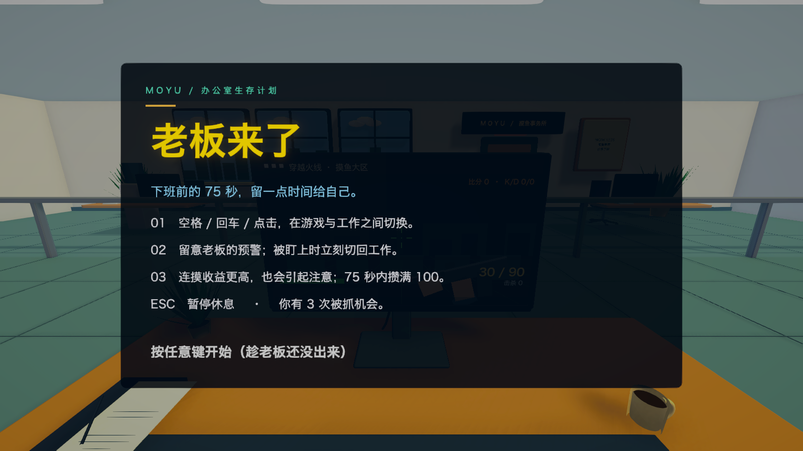
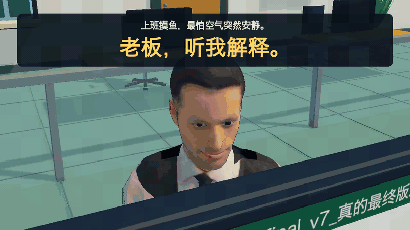
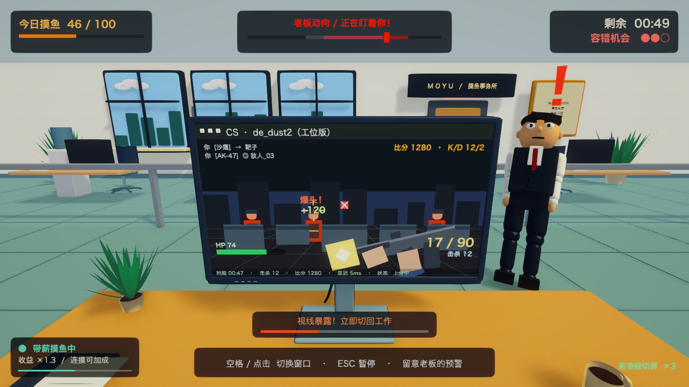

<p align="center">
  
</p>

<h1 align="center">老板来了 · Boss Is Coming</h1>

<p align="center"><strong>上班摸鱼不是技术，是演技。</strong></p>

<p align="center">
  75 秒办公室生存挑战 · 带薪打枪 · 一键切 Excel · 躲过老板的回头
</p>

<p align="center">
  <a href="https://github.com/Hao2048/BossIsComing/releases/latest">下载 macOS 版</a> ·
  <a href="#实机演示">观看演示</a> ·
  <a href="#怎么玩">游戏玩法</a> ·
  <a href="Docs/DESIGN.md">设计思路</a> ·
  <a href="#运行项目">运行源码</a>
</p>

<p align="center">
  
</p>

<p align="center"><sub>游戏开始画面 · 公开版本实机截图</sub></p>

一款固定工位视角的 Unity 小游戏：老板转身时带薪打枪，老板回头前一键切成 Excel。在下班前的 **75 秒** 里攒满摸鱼值，同时保住三次容错机会。

## 下载即玩

<p align="center">
  <a href="https://github.com/Hao2048/BossIsComing/releases/latest"><strong>下载 Boss Is Coming · macOS Universal DMG</strong></a><br>
  <sub>Apple Silicon / Intel · macOS 12+ · 无需安装 Unity</sub>
</p>

当前发布版为 **v0.1.0**，未进行 Developer ID 签名和 Apple 公证。安装与首次打开说明见 [macOS 指南](Docs/MACOS.md)。

## 实机演示

<p align="center">
  <a href="Showcase/boss-coming-showcase.mp4">
    
  </a>
</p>

<p align="center">
  <a href="Showcase/boss-coming-showcase.mp4"><strong>▶ 观看 / 下载 26 秒实机短片</strong></a><br>
  <sub>老板探头 → 带薪打枪 → 极限切屏 → 贪枪被抓 → 老板走了继续摸鱼</sub>
</p>

> 演示短片使用了可选下载的人物。公开仓库和 macOS 安装包自带原创卡通老板，克隆后即可运行。两种版本的玩法一致，可选人物导入步骤见[素材说明](Docs/ASSETS.md)。

## 怎么玩

玩家坐在工位前，屏幕里的射击游戏会自动瞄准和开火。你真正要操作的是**观察老板，决定什么时候摸鱼、什么时候装忙**。

<table align="center">
  <thead>
    <tr><th align="center">操作</th><th align="center">效果</th></tr>
  </thead>
  <tbody>
    <tr><td align="center">任意键</td><td align="left">从标题画面开始</td></tr>
    <tr><td align="center">空格 / 回车 / 鼠标点击</td><td align="left">在射击游戏和工作表格之间切换</td></tr>
    <tr><td align="center">Esc</td><td align="left">暂停 / 继续，倒计时和声音一起暂停</td></tr>
  </tbody>
</table>

一局中会发生这些事：

1. **老板不在，放心开枪。** 射击小场景提供连杀、爆头、换弹和复活的即时反馈。
2. **连续摸鱼，收益加速。** 连摸越久，每秒增长越快；但持续太久也会吸引老板注意。
3. **看到预警，准备切屏。** 老板会停步、虚晃、接电话，也会突然回头。
4. **切成表格，开始演。** 在安全窗口切换能躲过检查，及时反应还能得到“影帝级切屏”奖励。
5. **再贪一枪，也许就被抓。** 老板走到面前训话，摸鱼进度受损、容错机会减少；他离开后，枪战又能继续。

### 输赢与风险收益

<table align="center">
  <thead>
    <tr><th align="center">规则</th><th align="center">当前数值</th></tr>
  </thead>
  <tbody>
    <tr><td align="center">单局时限</td><td align="left">75 秒</td></tr>
    <tr><td align="center">胜利目标</td><td align="left">摸鱼值达到 100</td></tr>
    <tr><td align="center">摸鱼基础收益</td><td align="left">每秒 +4.4</td></tr>
    <tr><td align="center">连续收益上限</td><td align="left">连摸 6 秒达到 ×1.6</td></tr>
    <tr><td align="center">引起注意</td><td align="left">连摸约 5 秒后，老板会更早检查</td></tr>
    <tr><td align="center">工作时的代价</td><td align="left">摸鱼值每秒 -1.2</td></tr>
    <tr><td align="center">被抓判定</td><td align="left">被盯着时仍摸鱼，持续约 0.38 秒</td></tr>
    <tr><td align="center">被抓惩罚</td><td align="left">扣一次机会，并损失至少 15 点或当前一半进度</td></tr>
    <tr><td align="center">容错机会</td><td align="left">3 次；用尽或倒计时结束则失败</td></tr>
    <tr><td align="center">及时切屏奖励</td><td align="left">额外 +2.5 摸鱼值，并累计表演奖励</td></tr>
  </tbody>
</table>

**最稳的做法是认真工作，最诱人的做法是再打一枪。** 游戏的张力就来自这两种选择之间的摇摆。

## 有哪些好笑的地方

- 老板接电话时，屏幕会明确告诉你“放心摸”，于是安全窗口反而成了最忙的时候。
- 工作文件名写着 `final_v7_真的最终版.xlsx`，表格很认真，玩家未必认真。
- 一键从枪战切成经营分析报告，老板还可能夸你“这小伙子很忙”。
- 脚步声、突然的门响、假动作和回头，让人对办公室动静过度敏感。
- 被抓后老板走到面前训话；等他一走，玩家又继续摸鱼。

## 为什么这样设计

<table align="center">
  <thead>
    <tr><th align="center">设计选择</th><th align="center">想带来的体验</th></tr>
  </thead>
  <tbody>
    <tr><td align="center">固定工位视角</td><td align="left">让显示器、老板和雷达形成稳定的注意力分配，不靠移动操作增加负担</td></tr>
    <tr><td align="center">只保留一个核心按键</td><td align="left">上手门槛低，输赢归因到“判断和贪心”，而不是复杂操作</td></tr>
    <tr><td align="center">射击自动进行</td><td align="left">枪战负责热闹和即时反馈，切屏才是主玩法</td></tr>
    <tr><td align="center">连摸收益与主动检查联动</td><td align="left">让风险来自玩家主动选择，避免单纯等待随机惩罚</td></tr>
    <tr><td align="center">有预警的观察状态</td><td align="left">老板可以吓人，但抓人需要可读、可反应的窗口</td></tr>
    <tr><td align="center">卡通光照和程序动作</td><td align="left">用统一的夸张表现服务喜剧，而不是追求写实办公室的细枝末节</td></tr>
  </tbody>
</table>

更完整的取舍、状态机和技术实现见 [DESIGN.md](Docs/DESIGN.md)。

## 运行项目

1. 使用 **Unity 6000.6.0f1（Unity 6.6）** 打开仓库根目录。
2. 等待 Unity Package Manager 导入依赖。
3. 打开 **`Assets/Scenes/OfficeGame.unity`**。
4. 按 **Play**，再按任意键开始。

主要依赖：URP **17.6.0**、Input System **1.20.0**、uGUI。无需 Blender、FFmpeg 或命令行工具即可玩游戏；它们仅用于重新生成资源、录制或验证。

场景可通过 `Tools / 老板来了 / ① 生成场景` 重建。后处理直接编辑场景根节点的 `Global Volume` / `SampleSceneProfile`，程序不会生成更高优先级的覆盖层。

中文字体由系统提供。Windows、macOS 通常可直接显示；Linux 若缺字，请安装可用的中文字体，例如 Noto Sans CJK。

公开版本的默认画面（原创简化角色）：

<p align="center">
  
</p>

## 项目结构

```text
Assets/
  Scenes/OfficeGame.unity       可公开、可直接运行的场景
  Scripts/                     游戏状态、老板 AI、屏幕、HUD、音效与动作
  Scripts/Editor/              场景重建、可选人物配置、展示录制
  Resources/Realism/           原创办公家具网格（目录名沿用早期版本）
  Resources/Toon/              卡通材质、描边与接触阴影着色器
ArtSource/                     原创家具 / 材质生成脚本
Docs/                          玩法设计、开发与素材文档
QA/                            Unity Editor 自动验证脚本
Showcase/                      实机短片、GIF、封面和剪辑脚本
```

## 验证与当前范围

公开版本已在不加载可选人物的情况下进行游戏回归检查，覆盖开始、切屏、暂停 / 恢复、实际通关、表演奖励、重开、超时和被抓失败流程。验证方式见 [开发说明](Docs/DEVELOPMENT.md)。

目前是单局原型：没有联网、账号、存档或多关卡系统。射击场景是自动演出，不是完整 FPS；这份项目更适合学习轻量状态机、风险收益设计、程序化场景、卡通渲染和角色表现。

## 许可证与素材

原创代码、着色器、简化人物、办公家具和生成脚本采用 **[MIT](LICENSE)**。Unity 和 UPM 依赖遵循各自许可。

视频中的可选 Renderpeople 人物不随源码分发。仓库提供官方来源和本地导入说明；模型、贴图以及其衍生网格均被忽略。渲染视频与原始 3D 数据的许可范围不同，详见 [THIRD_PARTY_NOTICES.md](THIRD_PARTY_NOTICES.md)。
